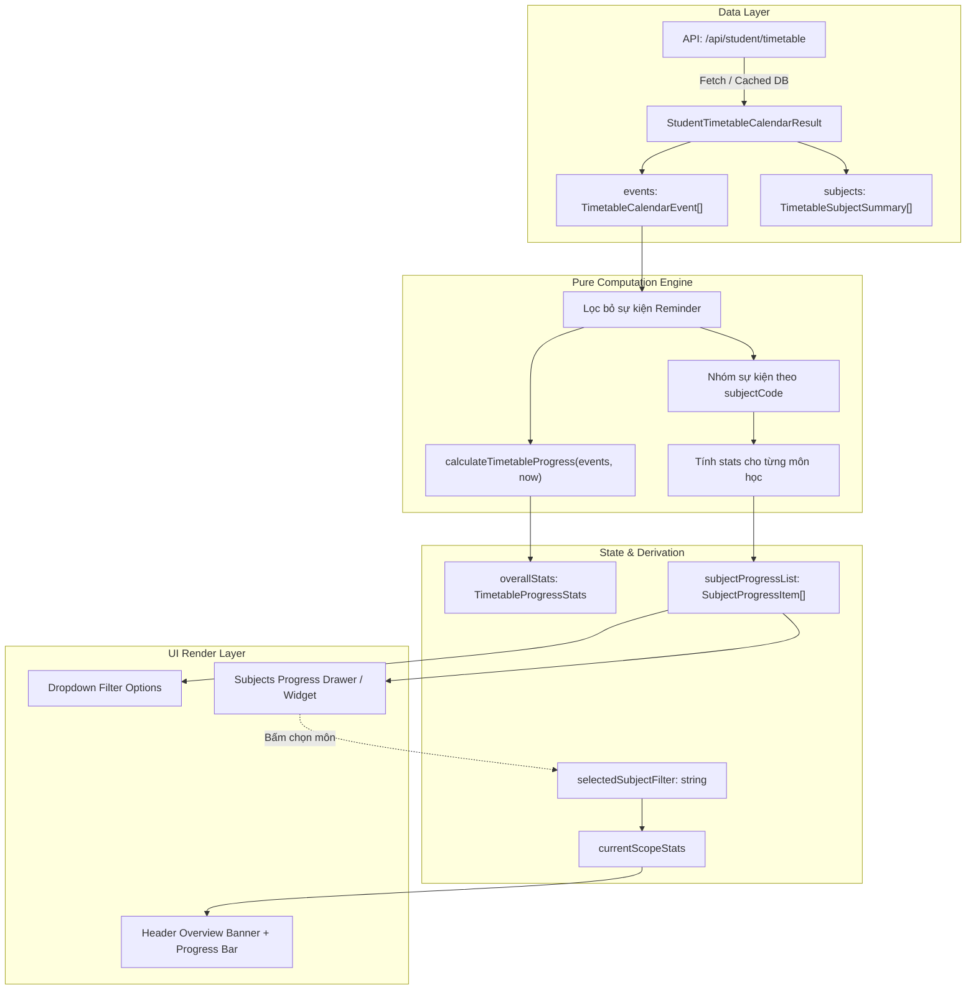

# Architecture Spine: Personal Timetable Session Progress & Subject Breakdown

## 1. Context & Objectives

Tính năng **Thời Khóa Biểu & Lịch Học Cá Nhân** (`StudentTimetableCalendar`) hiện đã hiển thị tổng số môn học và tổng số buổi học của học kỳ từ cổng QLDTTX.
Kiến trúc này quy chuẩn việc mở rộng hệ thống để:
1. Thống kê số buổi **Đã học** và **Còn lại** trên quy mô toàn bộ học kỳ (hoặc theo môn đang lọc).
2. Thống kê chi tiết chỉ số này (Tổng / Đã học / Còn lại / % Hoàn thành) cho **từng môn học riêng biệt**.

---

## 2. Invariants (Bất Biến Hệ Thống)

Các quy tắc bất biến giữ cho hệ thống không bao giờ phân kỳ, dù được xây dựng bởi bất kỳ lập trình viên hay agent nào:

- **INV-1 (Conservation Law):** Với mọi phạm vi (toàn khóa hay từng môn), đẳng thức sau luôn luôn đúng:
  $$\text{total} = \text{completed} + \text{remaining}$$
- **INV-2 (Single Source of Truth):** Danh sách `events: TimetableCalendarEvent[]` nhận từ API là nguồn chân lý duy nhất. Tiến độ học tập là **Derived State** (trạng thái phái sinh), tuyệt đối **không** lưu trữ trạng thái `completed`/`remaining` cố định trong Database cache hay `useState` cục bộ nhằm tránh mất đồng bộ dữ liệu.
- **INV-3 (Temporal Boundary Precision):** Ranh giới một buổi học đã kết thúc được xác định dựa trên cặp `(date, endTime)`. Không dùng ranh giới chỉ theo ngày (`date < today`) để tránh sai lệch vào các ngày có ca học tối.
- **INV-4 (Filter Coherence):** Khi kích hoạt bộ lọc môn học trên giao diện, chỉ số thống kê trên Header Banner phải phản ánh ngữ cảnh môn học đang chọn, đồng thời người dùng vẫn có thể xem tổng quan toàn kỳ thông qua widget chuyên dụng.

---

## 3. Architectural Decisions (ADs)

### AD-1: Temporal Completion Boundary
- **Binds:** Logic phân loại trạng thái của một `TimetableCalendarEvent`.
- **Prevents:** Tình trạng buổi học đã kết thúc lúc 21:50 nhưng ứng dụng vẫn báo là "còn lại" cho đến hết ngày, hoặc ngược lại tính là "đã học" trước khi ca học bắt đầu.
- **Rule:** Một buổi học được coi là **Đã học (Completed)** khi và chỉ khi:
  $$\text{event.date} < \text{todayIso} \quad \lor \quad (\text{event.date} = \text{todayIso} \ \land \ \text{nowMinutes} \ge \text{event.endMinutes})$$
  Trong đó:
  - `todayIso`: Chuỗi ngày định dạng `YYYY-MM-DD` theo giờ địa phương của client.
  - `nowMinutes`: Tổng số phút từ 00:00 của thời điểm hiện tại (`hours * 60 + minutes`).
  - `endMinutes`: Phút kết thúc của ca học (được suy ra từ `endTime` hoặc cấu hình tiết học). Nếu không có `endTime`, mặc định lấy `startMinutes + 170` (tiết 13->15 tương đương 2h50p).
  - Mọi buổi học không thỏa mãn điều kiện trên đều tính là **Còn lại (Remaining)**.

### AD-2: Calculation Boundary & Derived State Engine
- **Binds:** Vị trí tính toán thống kê và cấu trúc hàm xử lý.
- **Prevents:** Stale cache từ CSDL `StudentTimetableRecord` (cache TTL 10 phút), lệch múi giờ giữa máy chủ (UTC) và sinh viên (GMT+7).
- **Rule:** Toàn bộ việc tính toán tiến độ được thực hiện tại **Client** thông qua một Pure Function độc lập `calculateTimetableProgress`:
  ```typescript
  export interface TimetableProgressStats {
    total: number;
    completed: number;
    remaining: number;
    percentage: number; // Làm tròn 0 - 100
  }

  export function calculateTimetableProgress(
    events: TimetableCalendarEvent[],
    now: Date = new Date()
  ): TimetableProgressStats;
  ```
  Hàm này là pure function, nhận `events` và `now` (mặc định `new Date()`), cho phép kiểm thử tự động (Unit Test) độc lập mà không cần mock React hay DOM.

### AD-3: Subject-level Breakdown Mapping
- **Binds:** Cấu trúc dữ liệu thống kê theo từng môn học.
- **Prevents:** Trùng lặp logic gom nhóm môn học và đếm buổi học giữa Calendar view, Subject drawer và Filter select.
- **Rule:** Tiến độ từng môn được tổng hợp thành một `Map<string, SubjectProgressItem>`:
  ```typescript
  export interface SubjectProgressItem {
    subjectCode: string;
    subjectName: string;
    group: string;
    classCode: string;
    room: string;
    colorIndex: number;
    stats: TimetableProgressStats;
    isFinished: boolean; // stats.remaining === 0
  }
  ```
  Chỉ tính trên các sự kiện lớp học chính khóa (`!rawSession?.isReminder`), loại trừ các nhắc hẹn cá nhân được inject vào calendar.

### AD-4: UI Presentation & Interaction Pattern
- **Binds:** Trải nghiệm thị giác và vị trí hiển thị các chỉ số trên giao diện người dùng.
- **Prevents:** Rối mắt trên màn hình mobile, tràn chữ trong thanh điều hướng, đứt gãy luồng lọc lịch.
- **Rule:** 
  1. **Header Overview Bar:**
     - Hiển thị badge tiến độ tổng quan: `X/Y buổi (✓ Đã học: X • ⏳ Còn lại: Y)` kèm mini Progress bar mỏng 4px.
     - Tự động chuyển đổi ngữ cảnh khi `selectedSubjectFilter !== 'ALL'`: hiển thị tiến độ của riêng môn đang chọn, có nút "Xem toàn kỳ" để reset.
  2. **Subject Select Enhancer:**
     - Các option trong dropdown lọc môn học được bổ sung thông tin tiến độ:
       `[Tên môn] ([Mã môn]) — Đã học X/Y buổi`.
  3. **Subjects Progress Drawer/Modal (Dedicated Widget):**
     - Bổ sung nút bấm `"Tiến độ môn học"` trên thanh tác vụ (cạnh Đồng Bộ Lịch & Nhắc Hẹn).
     - Mở Drawer/Modal hiển thị danh sách tất cả các môn:
       - Tên môn, mã môn, số buổi đã học / còn lại / tổng.
       - Thanh tiến độ màu theo palette của môn đó.
       - Badge trạng thái: `Đang học` (Xanh/Vàng) hoặc `Đã hoàn thành` (Xám/Xanh lá).
       - Hành động bấm vào môn: Đóng drawer và lọc lịch trực tiếp về môn đó trên Calendar.

---

## 4. System Data Flow Diagram



---

## 5. File Structure & Boundaries

| File | Trách nhiệm | Thay đổi |
| :--- | :--- | :--- |
| `src/features/external-portal/utils/timetableProgress.ts` | Chứa Pure Functions & Interfaces tính toán tiến độ (`calculateTimetableProgress`, `deriveSubjectsProgress`) | **Tạo mới** |
| `src/features/external-portal/components/StudentTimetableCalendar.tsx` | Tích hợp hiển thị Header Progress, nâng cấp Dropdown filter, tích hợp modal/drawer tiến độ | **Chỉnh sửa** |
| `src/features/external-portal/components/SubjectsProgressModal.tsx` | Component hiển thị danh sách tiến độ các môn học dạng card/bảng trực quan | **Tạo mới** |

---

## 6. Deferred (Những hạng mục tạm hoãn)

- **Điểm danh thủ công:** Tự tích chọn buổi học có đi học hay nghỉ học (hiện tại tính 100% theo thời gian lịch trình của nhà trường).
- **Cảnh báo vắng quá số buổi quy định:** Tính tỷ lệ nghỉ cho phép (20% số tiết) để thi cuối kỳ (chờ tích hợp tính năng điểm danh cá nhân).
- **Push notification khi hoàn thành môn học:** Gửi tin nhắn Telegram chúc mừng khi môn học kết thúc buổi cuối cùng (để dành cho phase sau của Telegram Scheduler).
